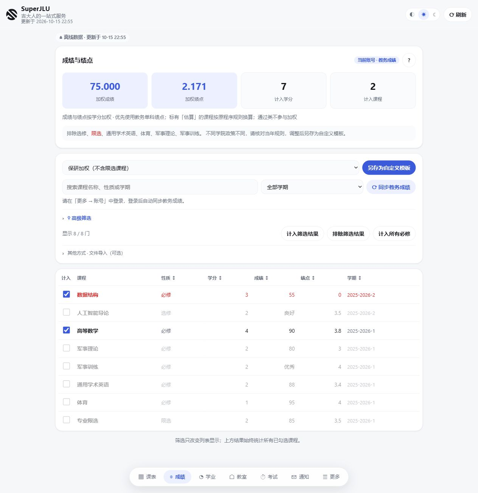
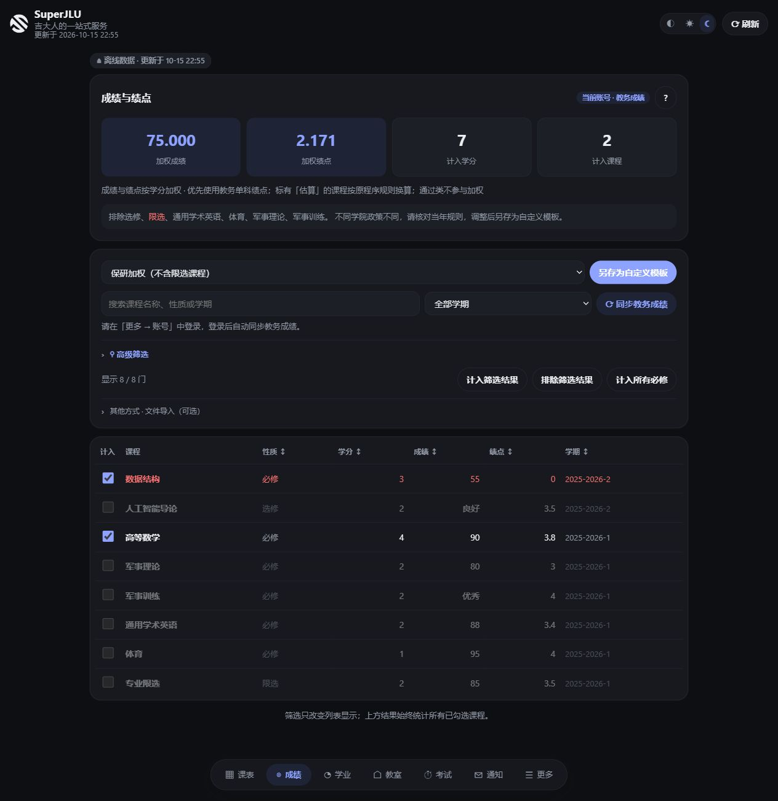

  

<h3 align="center">吉大人的一站式服务</h3>

  课表、成绩、绩点、学业进度、考试、空教室、校园通知…… 
  以前要在好几个网站之间来回跳，现在打开一个 App 就够了。

  <a href="https://github.com/Runa-Asahi/SuperJLU/releases/latest"><b>⬇️ 立即下载</b></a>
  ·
  <a href="#它能帮你做什么">看看能做什么</a>
  ·
  <a href="#常见问题">常见问题</a>

---

## 为什么用 SuperJLU？

- **登录一次就够了。** 输入账号密码、收一条微信验证码，之后很长一段时间都不用再登。图形验证码会自动识别，不用你眯着眼睛猜。
- **没网也能看。** 课表、成绩、考试都会存在你自己的手机或电脑上，断网、登录过期的时候照样能查。
- **你的数据只在你手里。** 所有内容都直接和学校服务器通信，账号和登录状态加密保存在本机，不经过任何第三方服务器。
- **手机电脑都能用。** Android 装个 App，Windows 双击就开，界面一样顺手，还有浅色和深色两种主题。

  
  

成绩与绩点页面（截图为示例数据）

## 它能帮你做什么

### 📅 课表：今天上什么课，一眼就知道
按周翻看课表，当天高亮，还会在顶部提醒你下一场考试还有几天。也可以导出到手机日历，课前 15 分钟自动提醒。

### 📊 成绩与绩点：保研、评奖学金前不用再手算
- 一键切换「保研加权」「奖学金加权」「全部课程」等计算方式，加权成绩和绩点马上算好。
- 想按自己学院的规则算？勾选要计入的课程，保存成自己的模板，下次直接用。
- 统计卡片会一直固定在屏幕上，边勾课程边看结果变化。

### 🎓 学业进度：离毕业还差多少学分
按培养方案列出每一类课程（通识、学科基础、专业课……）已修了多少、还差多少，点开就能看到具体是哪几门课，再也不怕漏修。

### 🏫 空教室：找个地方自习
选校区、教学楼、日期（或第几周星期几）、第几节课，马上列出空着的教室。还能按座位数筛选，自动屏蔽实验室这类特殊教室。

### ⏰ 考试安排：倒计时提醒
所有考试的时间地点集中在一页，并显示还剩几天，复习节奏心里有数。

### 📢 通知：重要消息不再错过
把吉大 OA 校内通知和学院官网的通知汇总在一起，可以搜索；订阅「讲座」「补考」「奖学金」这类关键词后，有新通知命中就能看到。

### 🔗 校园网站一键直达
教务系统、学在吉大一键免登录进入；选课、校园卡缴费、图书馆、VPN 也能一键打开，在校外时会自动给出 VPN 地址。

## 三步开始

1. **下载**：到 [Releases 页面](https://github.com/Runa-Asahi/SuperJLU/releases/latest) 下载最新版。
   - **Android 手机**：下载 `SuperJLU-版本号.apk`，直接安装。
   - **Windows 电脑**：下载 `SuperJLU.exe`，双击运行，会自动在浏览器里打开界面，右下角托盘里也能找到它。
2. **登录**：第一次打开会弹出登录框。账号是你的**吉大邮箱前缀**（不是学号），输入密码后，在「智慧吉大」里收微信验证码填进去。
3. **探索**：登录后会自动把课表、成绩、学业等数据同步下来，接下来就随便点点看吧 ✨

> 以后有新版本，直接下载新的安装包覆盖安装即可，数据和登录状态都会保留。

## 微信小程序（实验版）

[wechat/](wechat/README.md) 提供独立的微信原生小程序。默认通过本人手机 Safari 的学校教务会话读取数据，经复制、预览和确认后导入本机，可离线查看课表；更新时需手动重新读取，不需要电脑常开。可选后端和原生直连适配仍属试验功能，受学校网络与页面校验限制。运行方式、数据处理和已验证范围见该目录说明。

## 微信小程序端

> 随 [v1.0.8](https://github.com/Runa-Asahi/SuperJLU/releases/tag/v1.0.8) 发布，代码在仓库的 `wechat/` 目录。

SuperJLU 现在多了一个**微信原生小程序**，没有安卓 App 的同学（比如 iPhone 用户）也能在手机上查自己的教务数据。原有的桌面端、安卓 App 和 Python 包都不受影响。小程序共 12 个页面：课表、成绩与绩点、考试、学业、校园入口、个人设置、隐私说明等。

### 怎么用

1. 在手机浏览器（如 Safari）里登录学校教务系统。
2. 运行 SuperJLU 提供的同步书签，复制这次读取到的结果。
3. 打开小程序，预览、确认后导入本机。

导入后可以离线查看；想更新数据时，重新读取一次即可，**不需要电脑开着**。

### 隐私与安全

- 同步书签只在学校教务域名下运行，不加载远程脚本。
- 不导出 Cookie、密码或验证码，也不把结果上传到任何自建云端。
- 导入时会校验来源、时间、大小和字段，读取失败的模块会明确标出来。
- 默认不调用微信登录或任何后端。

### 目前的限制

- 小程序直连教务、云端查询这两种方式还在试验阶段，暂不支持后台自动同步。
- 手机浏览器模式不提供实时的空教室和通知查询。
- 成绩、考试等模块还没逐项在真机上验收，安卓浏览器也还没实测。
- 本地缓存没有额外加密，导入结果会暂时留在剪贴板里，可以手动清除。
- 小程序还要另外经过微信平台审核才能正式上架。

详细说明见 [`wechat/README.md`](wechat/README.md) 和 [`wechat/docs/backend.md`](wechat/docs/backend.md)。

## 致谢

### 特别感谢 Dramadan-wow 🎉

微信小程序端是 [**@Dramadan-wow**](https://github.com/Dramadan-wow) 通过 [PR #82](https://github.com/Runa-Asahi/SuperJLU/pull/82) 一手做出来的，这是 SuperJLU 到目前为止最大的一次外部贡献：

- 从零搭起完整的小程序，共 12 个页面；
- 设计了手机浏览器加书签的同步方案，绕开了小程序不能直连教务的问题；
- 在隐私边界上考虑得很细，不碰密码和 Cookie，也不上传任何数据；
- 补齐了测试（前端 60 项、后端 26 项，原有的 291 项也都通过），还加了独立的 CI 和完整文档。

如果你觉得小程序好用，欢迎去 GitHub **关注 [@Dramadan-wow](https://github.com/Dramadan-wow)** ⭐

### 也感谢 Aohpup

[**@Aohpup**](https://github.com/Aohpup) 一直在帮忙打磨成绩页：

- [PR #67](https://github.com/Runa-Asahi/SuperJLU/pull/67) 改进了模板反馈和吸顶汇总，还修好了安卓上确认框弹不出来的问题；
- [PR #81](https://github.com/Runa-Asahi/SuperJLU/pull/81) 修好了成绩单解析、拖放和安卓上传，又新增了成绩核对、模板恢复、差值展示和紧凑吸顶。

谢谢你，也欢迎关注 [@Aohpup](https://github.com/Aohpup)！

## 常见问题

**登录要用什么账号？**
吉大统一身份认证的账号，也就是你的吉大邮箱 `@` 前面那部分，不是学号。

**会不会泄露我的账号密码？**
不会。SuperJLU 只和学校的服务器直接通信，账号和登录状态加密存在你自己的设备上（Windows 凭据管理器 / Android Keystore），没有任何中间服务器。代码完全开源，欢迎检查。

**在校外能用吗？**
大部分功能可以。个别教务页面学校要求校园网或学校 VPN，遇到连不上时连一下 VPN 再刷新就好。

**数据不是最新的怎么办？**
点右上角的「刷新」按钮，会重新从教务系统同步一次。

**装过旧版「JLU Toolkit」？**
旧版包名不同，请先卸载旧版再安装 SuperJLU。

**怎么确认下载的文件没被篡改？**
每个安装包旁边都有一个 `.sha256` 文件，可以用来核对（Windows 在 PowerShell 里运行 `Get-FileHash 文件名`）。

## 遇到问题或有好点子？

欢迎到 [Issues](https://github.com/Runa-Asahi/SuperJLU/issues) 反馈 bug 或提建议，截图越详细越好。也非常欢迎提交 Pull Request 一起改进 SuperJLU ❤️

## 给开发者和极客

SuperJLU 也提供命令行工具、本地 API，以及接入 AI 助手（MCP）的能力，可以让 Claude、Cursor 等直接回答「我明天有什么课」「这学期绩点多少」。安装方式和全部命令见 [命令行与开发者文档](docs/cli.md)。

---

SuperJLU 是同学自发开发的开源项目，与吉林大学官方无关。

