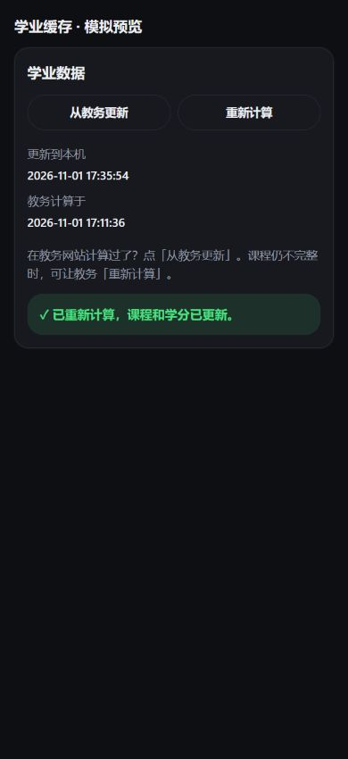
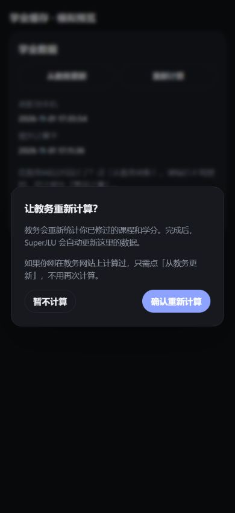

# 学业缓存与教务重新计算

普通同步已有学业总览和培养方案明细时，仅进入学业应用并读取计算时间，不重新查询课程、课组树或个人培养方案。同步摘要显示“缓存”。首次缺少数据、缓存不完整或账号/方案变更时才完整拉取。

缓存按学业摘要中的账号和方案标识的散列值校验，不将原始标识写入状态文件或接口响应。升级前的缓存没有归属记录，需要首次完整同步后才能安全复用。

页面仅显示“更新到本机”和“教务计算于”两个时间，格式统一为年月日和时分秒。最近核对时间仅供内部使用，不展示；教务计算时间变化时保留明细缓存，提示用户点击“从教务更新”。

“从教务更新”仅强制读取学业总览及培养方案明细，不请求学校重算、不刷新课表等其他模块。重算采用与程序其余功能一致的 HTML 二级弹窗，取消不会发请求。成功信息使用绿色状态块突出展示。

右上角“强制刷新”绕过学业缓存重新获取数据，**不调用学校重算接口**。

“教务重新计算”在用户确认后才启动异步任务。接口依据学校 `xywccx.js` 的 `actionCount` 和 `xywccxBS.js` 的 `queryZxjd`：

- 提交：`xywccx/modules/xywccx/bysc.do`，使用当前账号的 XH、PYFADM，BYNJDM 为 `-`，SCLBDM 为 `04`。
- 查询进度：`xywccx/modules/xywccx/byscjd.do`，ZXJDKEY 为 `BYSC_` 加当前账号标识。
- 每两秒查询一次，最多等待两分钟。进度完成且同一方案的计算时间改变，才重新同步学业和培养方案明细。不会再次执行全模块刷新。
- 同一服务器同时只允许一个任务；网络异常、超时后不自动重复提交。未确认计算和同步均完成时明确显示未确认，不报成功。
- 新增 GET/POST 路由沿用本地令牌与同源校验。请求体只接受确认标志，不接受浏览器提供的学号和方案号。

本地测试均使用合成响应；没有在真实账号上提交重算。维护者仍需在校园网/应用内 WebVPN 下分别验收学校返回协议、计算耗时、重算完成后的课程数量及时间。

## 界面预览

以下为合成数据的手机窄屏预览，不含真实账号、课程或成绩。

